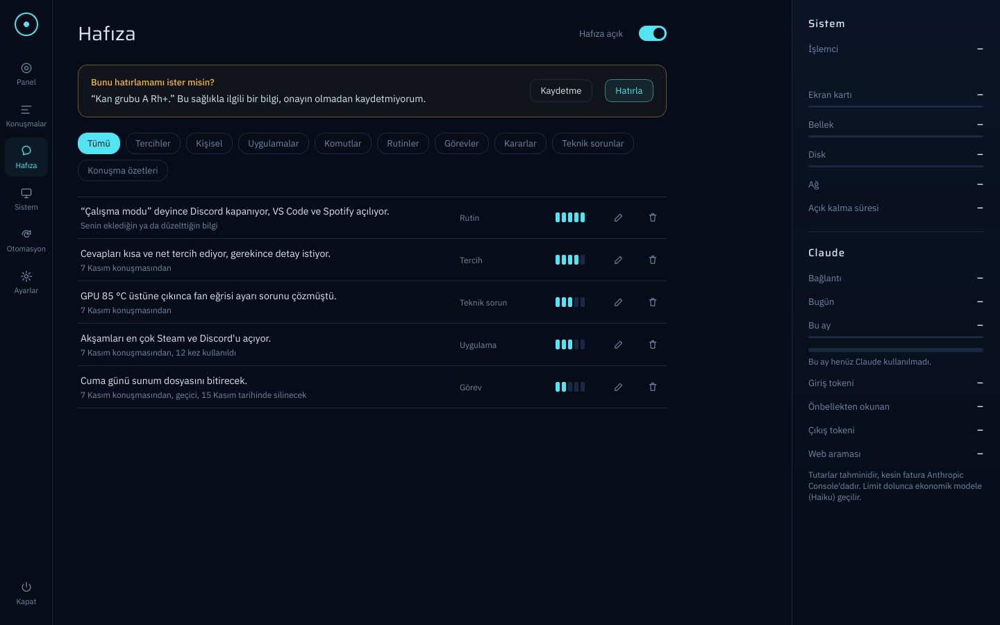

# Aşama 4 Test Raporu: Uzun Süreli Hafıza

**Tarih:** 2026-11-07
**Ortam:** Bulut Linux konteyneri, Python 3.13, anthropic SDK 2.6.0, SQLite 3.53 (FTS5), PySide6 (ekransız)
**Sonuç:** 140/140 otomatik test geçti (103 eski + 37 yeni). Gerçek API ile ücretli hafıza testleri **kullanıcının bilgisayarında yapılacak**.



## Kapsam

| Bileşen | Dosya |
|---|---|
| Şema (2. geçiş: `memories`, FTS5 dizini, tetikleyiciler, özet işaretleri) | `jarvis/storage/database.py` |
| Türkçe sadeleştirme, benzerlik, gizli/hassas bilgi tespiti | `jarvis/memory/text.py` |
| Kayıt, birleştirme, düzeltme, silme, süre dolumu | `jarvis/memory/store.py` |
| İlgili kayıtları bulma (bm25 + önem + yakınlık + kullanım) | `jarvis/memory/retrieval.py` |
| Bilgi çıkarma (yerel süzgeç + Haiku yapılandırılmış çıktı), açık komutlar | `jarvis/memory/extractor.py` |
| Konuşma özeti | `jarvis/memory/summarizer.py` |
| Sohbet akışına bağlama, bütçe, maliyet kaydı | `jarvis/memory/service.py` |
| Hafıza ekranı | `jarvis/interface/memory_view.py` |

## Nasıl test edildi?

Ücretsiz testler gerçek anthropic SDK'sını kullanır; yalnızca ağ katmanı sahtedir (`tests/fake_api.py`,
akışsız JSON yanıtı için `json_message` eklendi). Arayüz testleri pytest-qt ile ekransız çalışır.

## Kabul testleri (`tests/test_memory.py`, `tests/test_memory_ui.py`)

| # | Test | Beklenen | Sonuç |
|---|---|---|---|
| 1 | Veritabanı kapatılıp açılır | Kayıtlar ve arama dizini kalıcı | ✅ |
| 2 | "KAHVEMİ", "İŞIK", "isik" ile arama | Ekli ve büyük harfli Türkçe kelimeler doğru kaydı bulur | ✅ |
| 3 | İlgi sıralaması | Önemli, yeni ve sık kullanılan kayıt önde; ilgisiz soruda yalnızca temel tercihler | ✅ |
| 4 | Aynı bilgi tekrar gelir | Yeni kayıt eklenmez, mevcut güncellenir; "annesinin/babasının doğum günü" ayrı kalır | ✅ |
| 5 | Geçici bilgi | Süresi dolunca görünmez ve silinir | ✅ |
| 6 | Hassas bilgi (model "hassas değil" dese bile) | Onay bekler, onaylanmadan isteğe eklenmez | ✅ |
| 7 | Çıkarım | Asla doğrulanmış kaydedilmez; tekrar gelse de onaylanmaz; onaylı kaydı değiştiremez | ✅ |
| 8 | Parola, API anahtarı, kart numarası | Hiç kaydedilmez; düzenlemeyle de eklenemez; mesajda varsa API'ye gönderilmez | ✅ |
| 9 | Basit sorular ("İstanbul'un nüfusu kaç") | Hafıza için API çağrısı yapılmaz | ✅ |
| 10 | Bilgi çıkarma isteği | Haiku 5.5, effort `low`, düşünme kapalı, `output_config.format` JSON şeması | ✅ |
| 11 | Maliyet | Her hafıza çağrısı "hafıza" nedeniyle kaydedilir (ret dahil), maliyet paneli güncellenir | ✅ |
| 12 | Hafıza kapalı | Çağrı yok, bağlam yok, özet yok; Claude'a "hafıza kapalı" denir | ✅ |
| 13 | "Bunu hatırla: ..." internet yokken | Yerel olarak kaydedilir | ✅ |
| 14 | "Kahve tercihimi unut", "bunu unut" | İstekten önce silinir, Claude'a ne silindiği söylenir; bulunamazsa söylenir | ✅ |
| 15 | "Adım Deniz değil, Demir" | Yanlış kayıt düzeltilir (`replaces_id`) | ✅ |
| 16 | Bütçe doldu, politika "durdur" | Hafıza çağrısı yapılmaz | ✅ |
| 17 | API hatası / ret | Çökme yok, kayıt yok | ✅ |
| 18 | Konuşma özeti | Kısa konuşma özetlenmez; uzun olan 1-2 cümle; selamlaşma "gereksiz"; silinen özet geri gelmez | ✅ |
| 19 | 30 dk sonra yeni konuşma | Önceki konuşma arka planda özetlenir | ✅ |
| 20 | Önbellek | Sabit sistem bloğu hafızalı ve hafızasız istekte bayt bayt aynı; hafıza yalnızca değişken blokta | ✅ |
| 21 | Etiketler | "doğrulanmış" / "doğrulanmamış çıkarım"; onay bekleyen hassas bilgi isteğe hiç girmez | ✅ |
| 22 | Hafıza ekranı | Satırlar, kategori filtresi, önem çubuğu, boş durum metni | ✅ |
| 23 | Onay kartı | "Hatırla" onaylar, "Kaydetme" siler; sağlık bilgisi için "sağlıkla ilgili" açıklaması | ✅ |
| 24 | Düzenleme penceresi | Metin/kategori/önem/geçicilik değişir; gizli bilgi yazılırsa reddedilir | ✅ |
| 25 | Silme | Onay penceresi; "Vazgeç" silmez, "Sil" siler | ✅ |
| 26 | Aç/kapa anahtarı | Ayar dosyasına yazılır, kapalıyken açıklama görünür | ✅ |
| 27 | Onay bekleyen yeni kayıt | Panelde uyarı bandı ve "Hafıza" kısayolu | ✅ |

## Bilinen sınırlar

- **Kök bulma kabadır** (ilk 5 harf). Ünsüz yumuşaması ("ışık" / "ışığı") ve çok kısa köklerde eşleşme kaçabilir.
  Hafıza kayıtları az olduğu için bm25 + önem + temel bilgiler bunu büyük ölçüde telafi eder; anlamsal (embedding)
  arama gerekirse sonraki aşamada eklenebilir.
- **Hassas bilgi tespiti** model + yerel anahtar kelime listesine dayanır. Liste bilerek geniştir ("doktor",
  "kredi" gibi); yanlış pozitif yalnızca fazladan bir onay sorusu demektir.
- **"unut" komutu** sorgudaki bütün kelimeleri içeren kayıtları siler; 5'ten fazla eşleşmede hiçbirini silmez ve
  Hafıza ekranını önerir.
- Hafıza açıkken "Hatırla" ile onaylanan hassas bilgi isteğe eklenir; kapatmak için Hafıza ekranından silinmelidir.
- **Uygulama çökerse** açık konuşma o an özetlenmez; bir sonraki açılışta (son 7 gün, en çok 3 konuşma) özetlenir.

## Kullanıcının bilgisayarında yapılacak canlı test (bekliyor)

Anahtarı girdikten sonra:

```
python -m pytest -m live tests/test_live_memory.py -v -s
```

2 test, toplam yaklaşık **$0,001-0,005**. Kontrol ettikleri: Haiku yapılandırılmış çıktıyla adı doğrulanmış
olarak kaydediyor mu, kan grubu hassas sayılıp onay bekliyor mu, maliyet "hafıza" olarak yazılıyor mu,
konuşma özeti çıkıyor mu.
